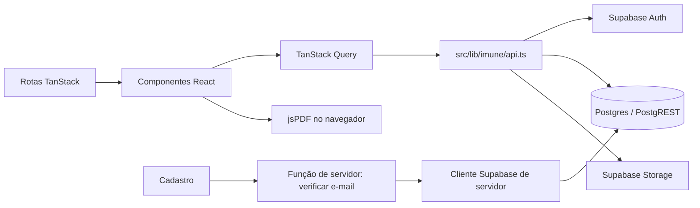
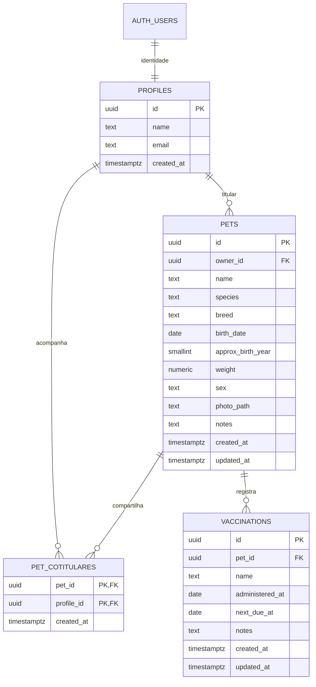

# Imune

Aplicação web para organizar o cadastro de pets, seus responsáveis e o histórico de vacinação. O Imune permite que um titular mantenha os dados do pet e compartilhe a visualização com um ou mais cotitulares.

Este documento descreve a arquitetura, as tecnologias e os fluxos que existem no código atual. Não é um roteiro de instalação.

## Visão geral do produto

O sistema reúne quatro áreas principais:

- **Contas:** cadastro e entrada com e-mail e senha.
- **Pets:** cadastro, consulta, edição e exclusão de pets; busca por nome ou raça; abas para pets próprios e compartilhados.
- **Cotitularidade:** relação opcional entre pets e perfis. Um pet pode ter vários cotitulares, que podem consultar os dados e vacinas, mas não alterar nem excluir o cadastro.
- **Vacinação:** registro de nome, data da aplicação, próxima aplicação e observações; histórico, status de vencimento e exportação em PDF.

A interface e as mensagens estão em português brasileiro. As páginas ajustam o layout a telas menores, incluindo abas empilhadas em larguras até aproximadamente 450 px e informações textuais que podem ocupar mais de uma linha.

## Tecnologias e responsabilidades

| Tecnologia                                          | Papel no Imune                                                                                                                                                                                                      |
| --------------------------------------------------- | ------------------------------------------------------------------------------------------------------------------------------------------------------------------------------------------------------------------- |
| **TypeScript 5.8**                                  | Tipos do domínio, contratos do Supabase e checagem estática. O `tsconfig.json` ativa modo estrito e define o alias `@/*` para `src/*`.                                                                              |
| **React 19**                                        | Componentes de interface, estado local de formulários e composição das telas.                                                                                                                                       |
| **TanStack Start**                                  | Base da aplicação web e integração entre navegação, renderização e funções executadas no servidor.                                                                                                                  |
| **TanStack Router**                                 | Rotas baseadas em arquivos, navegação, parâmetros, redirecionamentos e proteção das páginas autenticadas. `src/routeTree.gen.ts` é a árvore de rotas gerada.                                                        |
| **TanStack Query**                                  | Consultas assíncronas, cache por chave, estados de carregamento/erro e invalidação de dados depois de alterações.                                                                                                   |
| **Vite 8**                                          | Servidor de desenvolvimento e empacotamento da aplicação. A configuração do projeto conecta Vite a React, TanStack Start, Tailwind CSS, aliases TypeScript e Nitro.                                                 |
| **Nitro**                                           | Runtime de servidor integrado ao build do TanStack Start. A configuração seleciona o preset Vercel quando a variável `VERCEL` está definida.                                                                        |
| **Supabase JS 2**                                   | Cliente de autenticação, consultas ao Postgres via PostgREST e acesso ao Supabase Storage.                                                                                                                          |
| **Supabase Auth**                                   | Identidade, cadastro, sessão persistente, login por senha e logout.                                                                                                                                                 |
| **PostgreSQL no Supabase**                          | Banco relacional de perfis, pets, cotitulares e vacinações. Row Level Security define acesso por usuário.                                                                                                           |
| **Supabase Storage**                                | Armazenamento das fotos dos pets no bucket `pet-photos`.                                                                                                                                                            |
| **Tailwind CSS 4**                                  | Estilização utilitária, breakpoints responsivos e tokens CSS semânticos.                                                                                                                                            |
| **Radix UI**                                        | Primitivos acessíveis usados por controles como abas, seletores, popovers e diálogos.                                                                                                                               |
| **Componentes locais no padrão shadcn/ui**          | Camada reutilizável em `src/components/ui`. O projeto usa o estilo `new-york` configurado em `components.json`, com os componentes mantidos no próprio repositório. Não há dependência de runtime chamada `shadcn`. |
| **Lucide React**                                    | Ícones vetoriais da interface.                                                                                                                                                                                      |
| **date-fns**                                        | Parsing, comparação e formatação de datas; a interface usa a localidade `pt-BR`.                                                                                                                                    |
| **React Day Picker**                                | Calendário visual dentro dos seletores de data.                                                                                                                                                                     |
| **React IMask**                                     | Máscara de digitação para datas no formato `DD/MM/AAAA`.                                                                                                                                                            |
| **jsPDF**                                           | Geração local de carteiras de vacinação em PDF A4.                                                                                                                                                                  |
| **Sonner**                                          | Mensagens temporárias de sucesso e erro.                                                                                                                                                                            |
| **cmdk**                                            | Lista pesquisável de usuários usada no seletor de cotitulares.                                                                                                                                                      |
| **clsx, tailwind-merge e class-variance-authority** | Composição de classes Tailwind, resolução de classes conflitantes e variantes de componentes.                                                                                                                       |
| **tw-animate-css**                                  | Classes e animações auxiliares da camada visual.                                                                                                                                                                    |

### Ferramentas de código e build

- **Gerenciadores de pacotes:** `package.json` declara dependências; o repositório mantém `package-lock.json` (npm) e `bun.lock` (Bun). Não há campo `packageManager` fixando um único gerenciador.
- **Lint:** ESLint 9, configuração flat em `eslint.config.js`, regras recomendadas de JavaScript e TypeScript, regras de React Hooks e verificação de Prettier.
- **Formatação:** Prettier 3, opções em `.prettierrc` (`printWidth: 100`, ponto e vírgula, aspas duplas e vírgula final).
- **TypeScript:** compilação sem emissão de arquivos (`noEmit`), alvo ES2022, resolução `Bundler` e `strict: true`.
- **Integração de deploy:** `vercel.json` identifica TanStack Start como framework; o preset de Nitro muda para Vercel quando o ambiente define `VERCEL`.

Scripts declarados em `package.json`:

| Script      | Função                                       |
| ----------- | -------------------------------------------- |
| `dev`       | Inicia o servidor de desenvolvimento Vite.   |
| `build`     | Gera o build de produção.                    |
| `build:dev` | Gera um build com modo de desenvolvimento.   |
| `preview`   | Serve localmente o build gerado pelo Vite.   |
| `lint`      | Executa ESLint no repositório.               |
| `format`    | Aplica Prettier aos arquivos do repositório. |

Não há script `test` declarado em `package.json`.

### Inventário das dependências relevantes

As versões abaixo são as faixas declaradas em `package.json`, não uma transcrição de todas as dependências transitivas do lockfile.

| Pacote                             | Versão declarada  | Uso verificado no código                                                    |
| ---------------------------------- | ----------------- | --------------------------------------------------------------------------- |
| `react`, `react-dom`               | `^19.2.0`         | Componentes, hooks, renderização React e hydration.                         |
| `@tanstack/react-start`            | `1.168.32`        | Framework de rotas/app, funções de servidor e integração SSR.               |
| `@tanstack/react-router`           | `1.170.18`        | Roteamento, links, guards e navegação.                                      |
| `@tanstack/router-plugin`          | `1.168.23`        | Integração de rotas tipadas e geração da árvore de rotas pela configuração. |
| `@tanstack/react-query`            | `^5.101.1`        | Cache e ciclo de vida de consultas.                                         |
| `@supabase/supabase-js`            | `^2.112.4`        | Auth, PostgREST e Storage.                                                  |
| `tailwindcss`, `@tailwindcss/vite` | `^4.2.1`          | Utilitários CSS e plugin de build.                                          |
| `tw-animate-css`                   | `^1.3.4`          | Animações importadas pelo CSS global.                                       |
| `date-fns`                         | `^4.1.0`          | Operações e formatação de datas.                                            |
| `react-day-picker`                 | `^9.14.0`         | Calendário do `DatePicker`.                                                 |
| `react-imask`                      | `^7.6.1`          | Máscara do campo de data.                                                   |
| `cmdk`                             | `^1.1.1`          | Pesquisa de perfis no seletor de cotitulares.                               |
| `jspdf`                            | `^4.2.1`          | Documento PDF da carteira.                                                  |
| `lucide-react`                     | `^0.575.0`        | Ícones usados nas telas e componentes.                                      |
| `sonner`                           | `^2.0.7`          | Toaster e mensagens de feedback.                                            |
| `class-variance-authority`         | `^0.7.1`          | Variantes de botões, badges e outros componentes.                           |
| `clsx`                             | `^2.1.1`          | Construção condicional de class names via `cn()`.                           |
| `tailwind-merge`                   | `^3.5.0`          | Remoção de classes Tailwind conflitantes via `cn()`.                        |
| `vite`                             | `8.1.5`           | Dev server e build.                                                         |
| `@vitejs/plugin-react`             | `^5.2.0`          | Transformação e integração de React no build Vite.                          |
| `nitro`                            | `3.0.260603-beta` | Runtime/empacotamento de servidor configurado com TanStack Start.           |
| `typescript`                       | `^5.8.3`          | Linguagem e checagem estática.                                              |
| `eslint`                           | `^9.32.0`         | Linter.                                                                     |
| `prettier`                         | `^3.7.3`          | Formatador.                                                                 |
| `supabase`                         | `^2.118.0`        | CLI de banco/migrações usada no fluxo de trabalho do schema.                |

Os pacotes Radix estão divididos em módulos `@radix-ui/react-*`. Os usados diretamente pelas telas incluem:

| Primitivo Radix | Onde aparece                                                                      |
| --------------- | --------------------------------------------------------------------------------- |
| `alert-dialog`  | Confirmação antes de excluir um pet.                                              |
| `label`         | Associação semântica entre rótulos e campos.                                      |
| `popover`       | Calendário, seletor de cotitulares e sino de notificações.                        |
| `radio-group`   | Escolhas mutuamente exclusivas nos formulários.                                   |
| `select`        | Opções de formulário.                                                             |
| `slot`          | Composição de componentes, por exemplo botão que renderiza um link com `asChild`. |
| `tabs`          | Alternância entre pets próprios e compartilhados.                                 |

O catálogo também tem wrappers Radix de `accordion`, `aspect-ratio`, `avatar`, `checkbox`, `collapsible`, `context-menu`, `dialog`, `dropdown-menu`, `hover-card`, `menubar`, `navigation-menu`, `progress`, `scroll-area`, `separator`, `slider`, `switch`, `toggle`, `toggle-group` e `tooltip`. Nem todos são importados pelos fluxos principais.

Ferramentas auxiliares declaradas no projeto:

| Pacote                                            | Versão declarada                 | Papel                                                    |
| ------------------------------------------------- | -------------------------------- | -------------------------------------------------------- |
| `@eslint/js`                                      | `^9.32.0`                        | Regras recomendadas de JavaScript.                       |
| `typescript-eslint`                               | `^8.56.1`                        | Parser e regras recomendadas de TypeScript para ESLint.  |
| `eslint-plugin-react-hooks`                       | `^5.2.0`                         | Regras de hooks React.                                   |
| `eslint-plugin-react-refresh`                     | `^0.4.20`                        | Regra de exports compatíveis com React Fast Refresh.     |
| `eslint-plugin-prettier`                          | `^5.2.6`                         | Executa a verificação Prettier pelo ESLint.              |
| `eslint-config-prettier`                          | `^10.1.1`                        | Desativa regras que conflitam com Prettier.              |
| `globals`                                         | `^15.15.0`                       | Globais de navegador na configuração ESLint.             |
| `vite-tsconfig-paths`                             | `^6.0.2`                         | Resolve aliases definidos no TypeScript durante o build. |
| `@types/node`, `@types/react`, `@types/react-dom` | Node `^22.16.5`; React `^19.2.0` | Declarações de tipo para TypeScript.                     |

O catálogo também inclui `embla-carousel-react`, `recharts`, `react-resizable-panels` e `vaul` para wrappers de carrossel, gráfico, painéis redimensionáveis e drawer. Esses wrappers não são importados pelas páginas principais atuais.

## Arquitetura da aplicação

O código separa rotas, componentes de domínio, componentes reutilizáveis, acesso a dados e integrações externas.

### Organização de pastas

| Caminho                      | Conteúdo e responsabilidade                                                                                |
| ---------------------------- | ---------------------------------------------------------------------------------------------------------- |
| `src/routes/`                | Rotas de autenticação, layout autenticado, listagem, cadastro, detalhe e edição de pets.                   |
| `src/components/imune/`      | Componentes específicos do produto: formulário, cartão, foto, cabeçalho, identidade visual e notificações. |
| `src/components/ui/`         | Componentes genéricos de interface, construídos sobre HTML e primitivos de UI.                             |
| `src/lib/imune/`             | Tipos do domínio, constantes, formatação, operações de dados e geração de PDF.                             |
| `src/integrations/supabase/` | Clientes Supabase, tipos do banco, autenticação e armazenamento de sessão.                                 |
| `src/hooks/`                 | Hooks compartilhados, como carregamento do perfil da sessão.                                               |
| `src/styles.css`             | Tailwind, tokens semânticos, estilos base e utilitários visuais da marca.                                  |
| `src/assets/`                | Recursos importados pelo código, incluindo a logo usada na interface e no PDF.                             |
| `public/`                    | Arquivos públicos servidos diretamente, como favicon e `robots.txt`.                                       |
| `supabase/migrations/`       | Histórico SQL usado para definir e alterar o schema do banco.                                              |

Arquivos de entrada e infraestrutura relevantes:

- `src/router.tsx` cria o roteador e seu `QueryClient`.
- `src/routes/__root.tsx` define o shell HTML, metadados, fontes, provider de consultas, rotas filhas e toaster global.
- `src/start.ts` configura middleware de tratamento de erros e proteção CSRF para funções de servidor.
- `src/server.ts` adapta a entrada do servidor TanStack Start e normaliza respostas de erro de SSR.
- `src/routeTree.gen.ts` é gerado a partir dos arquivos em `src/routes/`; não é a fonte manual das rotas.
- `vite.config.ts` configura o entry de servidor e o preset Nitro conforme o ambiente.

As páginas de login, cadastro e área autenticada desativam SSR no nível da rota. As verificações de sessão dessas páginas ocorrem no navegador; o servidor continua sendo usado pelas funções de servidor e pelo runtime TanStack Start.

### Rotas

| URL              | Função                                                                        | Acesso                                  |
| ---------------- | ----------------------------------------------------------------------------- | --------------------------------------- |
| `/`              | Redireciona para `/pets` se houver sessão; caso contrário, para `/login`.     | Público, com decisão baseada na sessão. |
| `/login`         | Entrada com e-mail e senha. Usuário autenticado é redirecionado para `/pets`. | Público.                                |
| `/register`      | Criação de conta. Usuário autenticado é redirecionado para `/pets`.           | Público.                                |
| `/pets`          | Lista pets próprios ou compartilhados, com busca por nome/raça.               | Autenticado.                            |
| `/pets/new`      | Cadastro de pet, cotitulares opcionais, foto e vacinas.                       | Autenticado; criação de pet.            |
| `/pets/$id`      | Detalhes, carteira de cuidados, histórico de vacinação e exportação PDF.      | Titular ou cotitular.                   |
| `/pets/$id/edit` | Edição do perfil, dos cotitulares e do histórico de vacinas.                  | Somente titular.                        |

O layout `/_authenticated` verifica `supabase.auth.getUser()` em `beforeLoad`. Sem usuário autenticado, redireciona para `/login`. O detalhe também compara `owner_id` com o perfil carregado para exibir controles de edição e exclusão apenas ao titular; as políticas do banco repetem a autorização para proteger os dados independentemente da interface.

## Autenticação e perfil

### Método de autenticação

- **Cadastro:** nome, e-mail, senha e confirmação de senha.
- **Login:** e-mail e senha, via `supabase.auth.signInWithPassword`.
- **Cadastro Supabase:** `supabase.auth.signUp`; o nome é enviado nos metadados do usuário e o redirecionamento de confirmação aponta para `/pets`.
- **Logout:** `supabase.auth.signOut`; antes, o cache de consultas React Query é cancelado e limpo.
- **Sessão:** o cliente Supabase mantém a sessão persistente e renova tokens automaticamente. O adaptador de armazenamento usa `localStorage` em hospedagem normal e suporta um broker por `postMessage` em contextos de pré-visualização embutidos.
- **Proteção de páginas:** os guards de rota chamam `supabase.auth.getUser()`; não dependem apenas de esconder botões.
- **Método não utilizado na jornada atual:** autenticação por OTP/código de uso único não está implementada nas telas. O pacote `input-otp` e seu wrapper existem no catálogo de UI, mas nenhuma rota os utiliza para login ou verificação.

O gatilho SQL `on_auth_user_created` chama `public.handle_new_user()` depois da criação de um usuário em `auth.users`. A função cria uma linha em `public.profiles`, usando o nome dos metadados quando disponível ou a parte anterior ao `@` como fallback.

### Validação de conta

Os formulários de login e cadastro mantêm valores e erros com estado React e validam manualmente antes do envio:

- E-mail obrigatório, com formato verificado por expressão regular.
- Nome obrigatório e com pelo menos dois caracteres.
- Senha obrigatória e com pelo menos seis caracteres no cadastro.
- Confirmação deve coincidir com a senha.
- O cadastro faz uma consulta de disponibilidade de e-mail enquanto a pessoa digita, com debounce de 500 ms.
- A consulta de disponibilidade é uma função TanStack Start em `src/lib/imune/auth.functions.ts`. Ela valida e normaliza o e-mail e consulta `profiles` por meio do cliente Supabase de servidor.
- A verificação antecipada é informativa; a resposta de `signUp` do Supabase continua sendo a decisão final sobre duplicidade e regras de autenticação.

### Clientes Supabase

- `src/integrations/supabase/client.ts`: cliente usado pelo navegador para Auth, tabelas e Storage. Lê `VITE_SUPABASE_URL` e `VITE_SUPABASE_PUBLISHABLE_KEY`, com fallback de SSR para `SUPABASE_URL` e `SUPABASE_PUBLISHABLE_KEY`.
- `src/integrations/supabase/client.server.ts`: cliente de servidor que usa `SUPABASE_URL` e `SUPABASE_SERVICE_ROLE_KEY`. É carregado dinamicamente pela verificação de e-mail; a chave de serviço não faz parte do cliente de navegador.
- `src/integrations/supabase/auth-middleware.ts`: contém um helper que valida um bearer token com `getClaims`. No código atual, as rotas autenticadas usam guards do TanStack Router e essa função não está ligada às consultas de pets.
- `src/integrations/supabase/types.ts`: tipos gerados para as tabelas e relacionamentos do Supabase.

## Modelo de dados

O schema da aplicação usa UUIDs e chaves estrangeiras. `auth.users` é mantida pelo Supabase Auth; `profiles` estende a identidade com os campos usados pelo produto.

### Tabelas e regras de integridade

#### `profiles`

| Coluna       | Descrição                                                                  |
| ------------ | -------------------------------------------------------------------------- |
| `id`         | UUID e chave primária; referencia `auth.users.id` com exclusão em cascata. |
| `name`       | Nome apresentado nas telas e nos seletores de cotitulares.                 |
| `email`      | E-mail da conta.                                                           |
| `created_at` | Data de criação, preenchida com `now()` por padrão.                        |

Usuários autenticados podem consultar perfis; cada usuário só pode inserir ou atualizar o próprio registro. A leitura ampla permite procurar pessoas pelo nome/e-mail no seletor de cotitulares.

#### `pets`

| Coluna                     | Descrição                                                                                     |
| -------------------------- | --------------------------------------------------------------------------------------------- |
| `id`                       | UUID primário, gerado automaticamente ou informado pela aplicação.                            |
| `owner_id`                 | Perfil titular; obrigatório e com cascata na exclusão do perfil.                              |
| `name`                     | Nome do pet.                                                                                  |
| `species`                  | Espécie textual limitada a `cao` ou `gato`.                                                   |
| `breed`                    | Raça escolhida ou texto informado em “Outro”.                                                 |
| `birth_date`               | Data de nascimento exata, opcional.                                                           |
| `approx_birth_year`        | Ano aproximado, opcional. A constraint exige exatamente um entre data exata e ano aproximado. |
| `weight`                   | Peso numérico, maior que zero.                                                                |
| `sex`                      | Valor limitado a `macho` ou `femea`.                                                          |
| `photo_path`               | Caminho da foto no bucket `pet-photos`.                                                       |
| `notes`                    | Observações opcionais.                                                                        |
| `created_at`, `updated_at` | Timestamps; `updated_at` é atualizado por trigger.                                            |

Há índice por `owner_id`. A lista de raças é definida na aplicação e varia conforme a espécie.

#### `pet_cotitulares`

Tabela de associação muitos-para-muitos:

- `pet_id` referencia `pets.id` e `profile_id` referencia `profiles.id`; ambas as FKs removem a relação em cascata.
- Chave primária composta `(pet_id, profile_id)` impede duplicar a mesma associação.
- Um pet pode ter zero, um ou vários cotitulares.
- `profile_id` tem índice para localizar rapidamente os pets compartilhados com uma pessoa.
- A relação não confere permissão de edição: cotitulares consultam; o titular administra o pet.

#### `vaccinations`

| Coluna                     | Descrição                                                      |
| -------------------------- | -------------------------------------------------------------- |
| `id`                       | UUID primário.                                                 |
| `pet_id`                   | Pet associado; a exclusão do pet remove as vacinas em cascata. |
| `name`                     | Nome da vacina.                                                |
| `administered_at`          | Data da aplicação registrada.                                  |
| `next_due_at`              | Data da próxima aplicação prevista.                            |
| `notes`                    | Observações opcionais.                                         |
| `created_at`, `updated_at` | Timestamps; `updated_at` é atualizado por trigger.             |

Uma constraint de banco exige `next_due_at >= administered_at`. A interface limita as duas datas a 01/01/2000–31/12/2034; esse intervalo é uma validação do formulário, não uma constraint de banco.

#### Relações e exclusões

- Um perfil titular possui muitos pets.
- Pets e perfis cotitulares se relacionam por `pet_cotitulares`.
- Um pet possui muitas vacinações.
- A exclusão de um perfil titular remove seus pets; excluir um pet remove vacinações e relações de cotitularidade.
- A foto é um objeto no Storage, não uma linha de tabela. `photo_path` guarda sua referência.

## Autorização e segurança de dados

As tabelas públicas têm Row Level Security habilitada. O cliente de navegador usa a chave publicável e o token da sessão; as policies PostgreSQL decidem que linhas ele pode ler ou alterar.

| Recurso                    | Leitura                                                  | Criação/alteração/exclusão                                                                     |
| -------------------------- | -------------------------------------------------------- | ---------------------------------------------------------------------------------------------- |
| Perfis                     | Qualquer usuário autenticado pode consultar perfis.      | Cada pessoa pode inserir/atualizar o próprio perfil.                                           |
| Pets                       | Titular e cotitulares vinculados.                        | Somente o titular pode criar, editar ou excluir.                                               |
| Vacinações                 | Usuários que podem consultar o pet correspondente.       | Somente o titular do pet pode inserir, editar ou remover.                                      |
| Relações de cotitularidade | A pessoa relacionada, o titular e os cotitulares do pet. | Somente o titular adiciona ou remove relações; não pode adicionar a si próprio como cotitular. |
| Fotos                      | Titular e cotitulares podem consultar a foto do pet.     | Escrita, atualização e remoção ficam limitadas à pasta do usuário titular.                     |

### Fotos

- Bucket esperado: `pet-photos`.
- Caminho salvo: `<owner_id>/<pet_id>/cover.<extensão>`.
- Tipos aceitos pelo formulário: JPG/JPEG, PNG e WEBP; limite de 5 MB.
- A aplicação gera URL assinada válida por uma hora para exibir e exportar a foto.
- SQL de políticas de Storage existe nas migrações. A criação do bucket em si não aparece como comando SQL nelas; o bucket precisa existir na configuração do projeto Supabase.

### Funções e triggers SQL

- `handle_new_user()`: cria perfil após novo usuário no Supabase Auth.
- `update_updated_at_column()`: define `updated_at = now()` antes de atualizar pets e vacinações.
- `is_pet_owner(uuid)` e `is_pet_cotitular(uuid)`: helpers `SECURITY DEFINER` usados por policies para validar relação com o pet.
- `rls_auto_enable()`: helper presente no snapshot do schema remoto para habilitação de RLS em tabelas públicas criadas.

## Fluxos principais da aplicação

### Perfil e listagem de pets

`useSession()` carrega o perfil atual por React Query, com chave `session-profile` e `staleTime` de 60 segundos. A listagem usa as chaves `pets/mine/<userId>` e `pets/shared/<userId>`; alternar aba consulta o escopo escolhido.

- **Meus pets:** busca pets cujo `owner_id` é o usuário atual.
- **Compartilhados comigo:** primeiro lê seus `pet_id` em `pet_cotitulares`, depois busca os pets e os dados do titular.
- A busca textual da tela filtra por nome do pet e raça; a ordenação da grade é por nome.
- O cartão mostra foto, nome, espécie, raça, idade e a vacinação com `next_due_at` mais próximo.
- Até 450 px, as abas ficam empilhadas; a partir de 451 px podem ficar lado a lado.

### Criar e editar pet

`PetForm` é compartilhado entre cadastro e edição. Ele usa inputs controlados e concentra validação antes de enviar `PetInput`, foto e array de `VaccineInput` para as rotas.

Validações de pet:

- Foto obrigatória ao cadastrar; opcional na edição.
- Nome, espécie, raça, data/ano de nascimento, peso e sexo obrigatórios.
- Peso numérico maior que zero; vírgula decimal é aceita e convertida para número.
- Nascimento exato entre 01/01/2000 e hoje ou ano aproximado de 2000 até o ano corrente; as duas formas são mutuamente exclusivas.
- Raça definida por espécie, com possibilidade de texto livre ao escolher “Outro”.
- Observações do pet são opcionais.

Validações de cada vacina:

- Nome e as duas datas são obrigatórios.
- Datas da aplicação e próxima aplicação entre 01/01/2000 e 31/12/2034.
- Próxima aplicação não pode ser anterior à data da aplicação.
- Observações opcionais.

Cotitulares são opcionais e múltiplos. O dropdown usa `cmdk`, pesquisa por nome ou e-mail e permite marcar/desmarcar perfis. A opção “Nenhum cotitular” limpa as seleções.

Operações de dados em `src/lib/imune/api.ts`:

1. Cadastro gera um UUID, envia a foto ao Storage e cria o pet.
2. A aplicação sincroniza as associações em `pet_cotitulares` e insere as vacinas.
3. Se uma etapa do cadastro falhar, o código tenta remover os registros/foto já criados.
4. Edição atualiza o pet, calcula quais relações cotitulares adicionar/remover e substitui as linhas de vacinação pelo array enviado pelo formulário.
5. Exclusão remove o pet; FKs em cascata removem vacinas e associações. A foto é removida do Storage pela aplicação.

### Carteira de cuidados e status

A página `/pets/$id` apresenta dados cadastrais, titular/cotitulares e histórico em ordem decrescente pela data de aplicação (`administered_at`). Cotitulares podem consultar a carteira; edição e exclusão ficam disponíveis somente ao titular.

`nextVaccinationStatus()` recebe `next_due_at` e compara com a data local atual:

| Diferença para próxima aplicação | Texto/status                                        |
| -------------------------------- | --------------------------------------------------- |
| Mais de um dia                   | “Faltam N dias”; atenção quando faltam até 30 dias. |
| Um dia                           | “Falta 1 dia”.                                      |
| Hoje                             | “É hoje”.                                           |
| Passada                          | “Atrasada há N dias”, com status de perigo.         |

Cartões de pets e histórico usam `next_due_at` para a próxima aplicação/status.

### Notificações de vacinação

O sino do cabeçalho usa um popover; em telas estreitas aparece ao lado do botão de saída. Não é push do navegador nem e-mail: o componente consulta os dados da sessão e mantém leituras no armazenamento local do navegador.

- Busca vacinações dos pets próprios e compartilhados por `listPets("mine")` e `listPets("shared")`.
- O critério atual de notificação usa `administered_at`: hoje até os próximos 10 dias, inclusive. Datas passadas e datas além da janela são excluídas.
- O cartão exibe pet, vacina, data da aplicação e status (“Venceu hoje”, “Vence amanhã” ou “Vence em N dias”).
- Ordem: data de aplicação mais futura primeiro; em empate, nome do pet e depois nome da vacina.
- Clicar no sino abre a lista e marca os avisos presentes como lidos. O contador mostra somente os não lidos.
- IDs lidos são guardados em `localStorage`, sob chave com versão e ID do usuário. Isso não sincroniza leitura entre navegadores/dispositivos e não cria linha no banco.
- Clicar em uma notificação abre `/pets/$id`.
- O popover tem altura máxima de 70% da viewport, limitada a 32 rem; quando necessário, apenas a lista rola.

O campo de data da notificação é diferente daquele usado na previsão de status: notificação consulta `administered_at`; cartão e status de próxima aplicação consultam `next_due_at`.

### Exportação de PDF

`src/lib/imune/pdf.ts` gera o documento no navegador com jsPDF:

- Formato A4 com fundo, cores e logo do Imune.
- Perfil do pet, idade, espécie, raça, peso, sexo, titular e cotitulares.
- Observações e histórico em ordem decrescente pela data de aplicação.
- Cada vacina inclui data aplicada, próxima aplicação e observações.
- Divide conteúdo por páginas, inclui número da página e data de emissão.
- Usa URL assinada do Storage para tentar incorporar a foto; o PDF continua sendo produzido se a imagem estiver indisponível.
- O arquivo é salvo como `imune-<nome-do-pet>.pdf`.

## Formulários, datas e validação

Os formulários de conta e o `PetForm` são controlados diretamente com `useState`; validam os valores em funções locais e apresentam erros associados aos campos. A navegação foca o primeiro campo inválido. O formulário usa `noValidate` para que as regras e mensagens do produto controlem a validação visível.

`react-hook-form`, `@hookform/resolvers` e `zod` estão listados como dependências; porém as rotas atuais não usam `useForm`, schema Zod nem resolver para validar o fluxo. `src/components/ui/form.tsx` contém uma camada genérica ligada a React Hook Form, mas não é usada pelo formulário do pet ou pelos formulários de autenticação.

### Seletor de data

O componente local `src/components/imune/DatePicker.tsx` combina:

- Input de texto com máscara `DD/MM/AAAA` (`react-imask`).
- Parsing e validação de datas reais com `date-fns`; valores persistidos são strings `yyyy-MM-dd`.
- Botão de calendário que abre um popover.
- Calendário `react-day-picker` em português brasileiro, navegação por mês e dropdown de ano.
- `minDate`/`maxDate` por contexto: nascimento de 01/01/2000 até hoje; aplicação e próxima aplicação entre 01/01/2000 e 31/12/2034.

`src/lib/imune/format.ts` centraliza datas sem hora, exibição `pt-BR`, idade, peso, espécie, sexo e estado da próxima vacina. Datas de banco são strings `date`; a conversão local reduz diferenças de fuso em datas sem horário.

## Interface e identidade visual

- A definição visual fica em `src/styles.css` com Tailwind CSS 4 e variáveis CSS semânticas.
- Cores são definidas em formato OKLCH, incluindo superfícies, texto, primária, azul da marca, sucesso, atenção e perigo.
- `Figtree` é a fonte de interface e `Outfit` a fonte de títulos; são carregadas pelo documento raiz, com fontes de sistema como fallback.
- `components.json` descreve componentes no estilo `new-york`, variáveis CSS e Lucide como família de ícones.
- `src/lib/utils.ts` expõe `cn()`, que combina `clsx` e `tailwind-merge`.
- Botões e badges usam `class-variance-authority` para variantes locais.
- `tw-animate-css` fornece utilitários de animação; `prefers-reduced-motion` reduz duração de movimento para quem solicita menos animação no sistema operacional.
- Breakpoints Tailwind controlam grades e espaçamento. Regras arbitrárias a partir de 451 px cobrem os componentes que precisam alternar exatamente no limite de 450 px.
- Labels, `aria-label`, mensagens relacionadas e estados de foco são usados nos controles interativos.

## Componentes e bibliotecas de UI

`src/components/ui` contém componentes React mantidos no projeto e prontos para composição. Os mais usados pelas telas atuais são:

- `Button`, `Input`, `Textarea`, `Label`, `Badge` e `Skeleton` para entrada, ações e carregamento.
- `Tabs` para alternar pets próprios/compartilhados.
- `Select` e `RadioGroup` para escolhas no cadastro.
- `Popover`, `Command` e `Calendar` para busca de cotitulares e seleção de datas.
- `AlertDialog` para confirmação de exclusão.
- `Sonner` para toasts globais.

A pasta também mantém wrappers genéricos para outros primitivos — menus, diálogos, accordion, tooltip, tabelas, gráficos, carrossel, drawers, áreas de rolagem e controles correlatos. A existência desses wrappers não significa que todos apareçam em uma tela do fluxo principal.

### Bibliotecas de UI presentes, mas não usadas no fluxo principal

- `input-otp` e `src/components/ui/input-otp.tsx`: wrapper de entrada OTP existe, mas não participa da autenticação atual.
- `react-hook-form` e `src/components/ui/form.tsx`: infraestrutura de formulário reutilizável existe, mas os formulários do produto usam estado React e validação manual.
- `zod` e `@hookform/resolvers`: listados no manifesto, sem uso nos formulários atuais.
- `recharts` e `embla-carousel-react`: wrappers de gráfico/carrossel estão no catálogo UI; as páginas do produto não os importam.
- `react-resizable-panels` e `vaul`: disponíveis por wrappers UI, sem uso nos fluxos atuais.

## Tratamento de erros e feedback

- `sonner` apresenta confirmação e falha de operações nas telas.
- Consultas com falha mostram estados de erro e opção de tentar novamente nos locais aplicáveis.
- A rota raiz fornece uma tela React de erro com ação para reiniciar a navegação; páginas inexistentes usam um estado 404 próprio.
- `src/start.ts` captura erros de middleware/funções e aplica middleware CSRF a funções de servidor.
- `src/server.ts` reconhece respostas de erro SSR normalizadas pelo runtime e devolve uma página HTML de contingência.
- `src/lib/error-capture.ts` preserva detalhes/causas de erro no log de servidor para erros que o runtime tenha convertido em resposta 500.

## Migrações e evolução do banco

Os arquivos SQL em `supabase/migrations/` registram a evolução do schema em ordem temporal:

| Migração                                                  | Papel                                                                                                                  |
| --------------------------------------------------------- | ---------------------------------------------------------------------------------------------------------------------- |
| `20260902225906_19641610-4467-4f51-a709-ff4a956ba712.sql` | Cria `profiles`, `pets`, `vaccinations`, constraints, índices, policies iniciais e triggers de perfil/timestamps.      |
| `20260902230004_ea7c5c79-c281-492a-8589-f0c981ada443.sql` | Restringe execução pública das funções de trigger.                                                                     |
| `20260928214348_remote_schema.sql`                        | Snapshot de funções e policies de Storage do schema remoto usado para alinhar o estado local.                          |
| `20260928220000_pet_cotitulares_many_to_many.sql`         | Cria a relação muitos-para-muitos de cotitulares, helpers/policies de acesso e remove a relação escalar antiga do pet. |

O estado final da aplicação usa `pet_cotitulares`; não há uma coluna de ID de cotitular no modelo TypeScript `Pet`.

## Dependências e componentes: observações de leitura

O conjunto de componentes `src/components/ui` é mais amplo que as páginas atuais. Ao explicar o projeto, diferencie:

1. **Tecnologias centrais em execução:** React, TanStack Start/Router/Query, Supabase, Tailwind, date-fns, Day Picker, IMask, Lucide, Sonner e jsPDF.
2. **Primitivos efetivamente presentes nas telas:** botões, inputs, abas, seletores, popovers, calendário, command list, alert dialog, badges e skeletons.
3. **Infraestrutura disponível, mas ainda sem fluxo de produto:** OTP, validação por Zod/React Hook Form, gráficos, carrossel e vários wrappers do catálogo.

Isso evita atribuir ao sistema fluxos ou funcionalidades apenas porque existe uma dependência ou um componente genérico no repositório.
